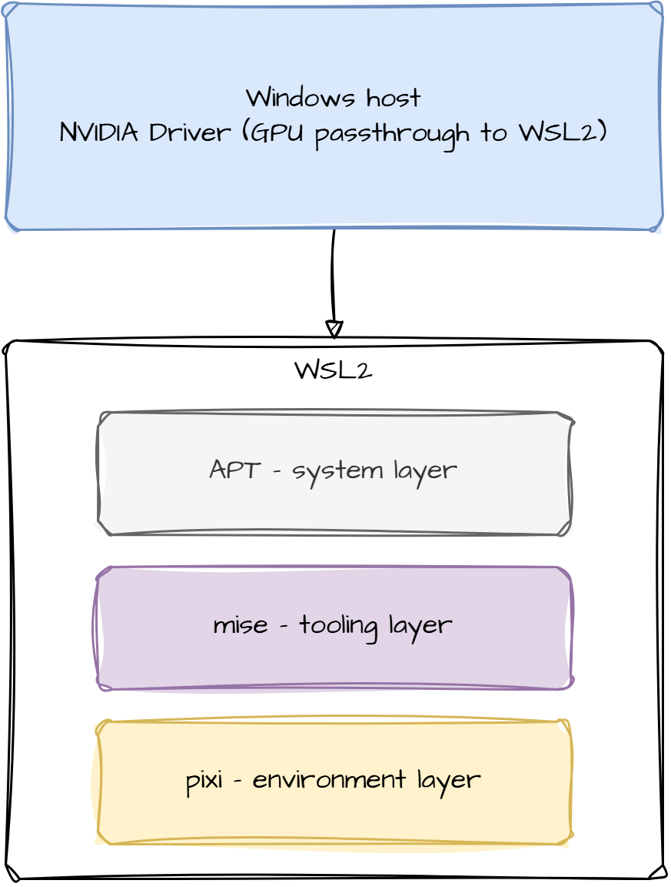

<div align="center">

# WSL

[](https://ubuntu.com/wsl)
[](https://github.com/geminitt/wsl)
[](./LICENSE)

**Workflow for AI**

</div>

---

## Prerequisites

| Requirement | Notes |
| --- | --- |
| Windows 11 | WSL2 support required |
| WSL-2 | `wsl --set-default-version 2` |
| NVIDIA Driver ≥ 525 | For CUDA passthrough into WSL |

---

## Architecture

> **NOTE:** Wezterm will not be used in this architecture because Windows Terminal is better suited to the Windows OS.
> I'm still waiting for the Ghostty terminal to be released on Windows 🫤~~~



**Tooling philosophy:**

- `apt` manages Ubuntu system packages, native libraries, build dependencies, and system-level services.
- `mise` manages developer tools, coding agents, and standalone runtimes used across projects.
- `pixi` manages isolated, reproducible project environments, including language runtimes, dependencies, and CUDA libraries when needed. `pixi global` manages shared CLI tools distributed through conda-forge, without `uv`.

**Principle**: Each tool has one primary package manager. Project dependencies belong to Pixi; shared development tools belong to mise; system-level dependencies belong to APT.

---

## Setup

### Windows side

``` bash
wsl --update
wsl --install <distribution> # I'm using the Ubuntu-26.04
```

***Options:***

Copy [WSL configuration](./.wslconfig) to `%UserProfile%`, then **adjust `memory` / `processors` / `swap` to match your actual host resources** — the checked-in values are tuned for the original machine, not a sane default for every host.

```powershell
copy .wslconfig $env:USERPROFILE\.wslconfig
wsl --shutdown  # reload the new limits
```

### WSL side

Clone the repository and run the installation script:

```bash
sudo apt update && sudo apt install -y git
git clone https://github.com/geminitt/wsl.git ~/wsl
cd ~/wsl
./install.sh
```

The script configures the environment in the following order:

1. System dependencies, Docker Engine, and optional NVIDIA Container Toolkit.
2. mise and shared developer tools.
3. Pixi and global CLI environments.
4. Shell configuration and managed dotfiles.
5. Installation verification.

The installation is designed to be safely repeatable. Existing configurations are preserved before replacement.

***Post-installation:***

Authenticate GitHub, Claude Code, and Hugging Face individually. Restart the WSL session when required for shell or Docker group changes.
